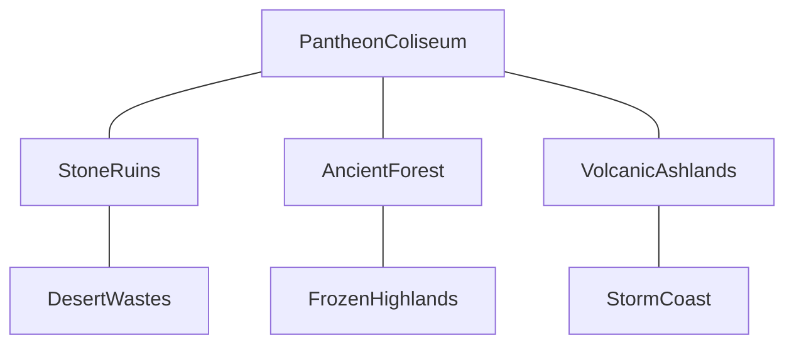

# Gods of the Arena — Arena World Design

**Date:** 2026-10-27  
**Engine:** UE 5.8  
**Multiplayer target (this phase):** **4 players** (host + 3 friends)  
**Status:** Implementation started — graybox + C++ architecture

---

## Vision

### A. Standalone arenas
Selectable maps with unique biome, atmosphere, encounter kit, and combat layout.

### B. The Shattered Dominion
One connected multi-biome battlefield. Continuous traversal — **no teleporter-hub** between biomes. Center: Pantheon Coliseum.

---

## Standalone arena roster

| ID | Name | Biome | Owned assets (if present) | Placeholder if missing |
|----|------|-------|---------------------------|------------------------|
| `Ashfall` | Ashfall Crucible | Volcanic | Lava Field Collections | Orange/red graybox + hazard stubs |
| `Frostbound` | Frostbound Citadel | Frozen | Iceland Collections *(not verified in project)* | Blue/white graybox |
| `Verdant` | Verdant Sanctuary | Forest | EuropeanBeech | Green graybox + simple pillars-as-trees |
| `Sunscar` | Sunscar Expanse | Desert | Moab materials / Geometry | Tan graybox |
| `Stormbreak` | Stormbreak Coast | Coast | Nordic Coast *(not verified)* | Gray cliff graybox |
| `Quarry` | Titan's Quarry | Stone | LevelPrototyping, StarterContent pillars | **First build — playable now** |

**Build order:** Quarry → Dominion 3-biome (Coliseum + Ruins + Forest + Volcanic) → remaining standalones → polish.

---

## Shattered Dominion (giant arena)

**Phase 1 prototype regions:** Coliseum + Ruins + Forest + Volcanic.  
Frozen / Desert / Coast expand after streaming + 4-player travel are proven.

**Modes later (design for, don't ship all now):** PvE Horde, PvE Conquest, PvP Duel (standalone), PvP Dominion, Story co-op.

---

## Technical architecture (UE 5.8)

| Concern | Standalone | Shattered Dominion |
|---------|------------|--------------------|
| Map type | Conventional (or WP later) | World Partition + Data Layers |
| Dressing | Hand + optional PCG | PCG for foliage/rocks; hand-author combat geo |
| Streaming | Minimal | Cell streaming + HLOD |
| MP | 4-player listen/dedicated | Relevancy + per-biome encounter activation |

### C++ (single `WarOfGods` module)

| Type | Role |
|------|------|
| `UArenaDefinition` | DataAsset: id, map, modes, biomes |
| `UBiomeDefinition` | DataAsset: tags, modifiers, presentation |
| `ABiomeVolume` | Overlap → typed biome enter/exit events |
| `AArenaEncounterDirector` | Server spawn pacing / waves (stub → expand) |
| `AArenaGrayboxBuilder` | Runtime placeholder geometry |
| `AArenaGameMode` / `AArenaGameState` | 4-player rules, arena phase |
| `AArenaPlayerStart` | Tagged team/slot starts |

Integrates with existing `UCombatComponent` events — does **not** replace combat/AI.

---

## Asset integration matrix

| Biome | Prefer | Fallback |
|-------|--------|----------|
| Stone / Quarry | `LevelPrototyping`, `StarterContent/Architecture` | Engine cube |
| Forest | `EuropeanBeech` (local, gitignored) | Green scaled cylinders |
| Volcanic | LavaField maps/materials | Red floor planes + hazard volumes |
| Desert | Moab MI / Geometry | Tan boxes |
| Frozen / Coast | Not confirmed in Content | Colored graybox until packs land |

Do **not** import Hillside sample / vehicles / full Megascans 3D_Assets dump.

---

## Multiplayer (4 players)

- `MaxPlayers = 4`
- Server-authoritative spawns, hazards, encounter state
- Test: listen server + 3 clients; players in different biomes (Dominion)
- Encounter budgets: only simulate active biome pods

---

## Performance constraints

- Combat readability > distant detail  
- Measure before claiming WP/HLOD success  
- Graybox first; Nanite/Megascans dress after layouts play

---

## Implementation status

| Deliverable | Status |
|-------------|--------|
| This design doc | Done |
| C++ arena architecture | In progress |
| Titan's Quarry graybox | In progress (runtime builder) |
| Dominion 3-biome graybox stub | In progress |
| World Partition map | Deferred until graybox traversal feels right |
| Full art dress | Deferred |
