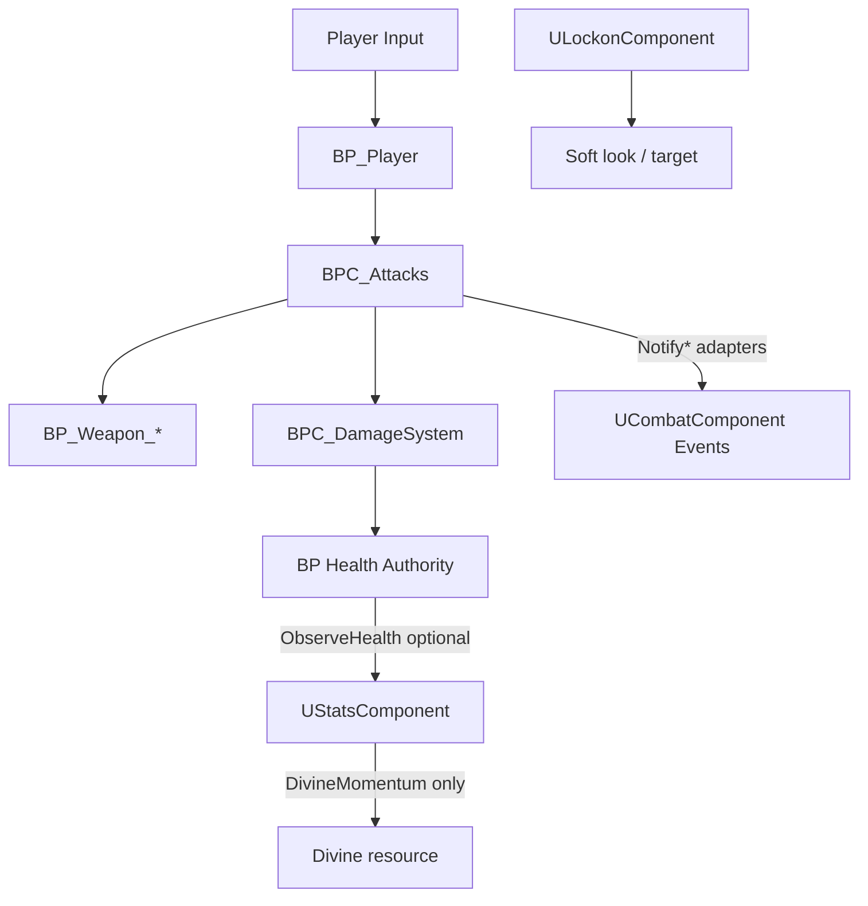

# Gods of the Arena — Combat Design Spec

**Date:** 2026-10-27  
**Engine:** UE 5.8  
**Status:** Phase 1 — contracts from existing BP behavior + target timing (tunable, not final)

---

## Ownership (Phase 1)

| Value | Authority now | Observer |
|-------|---------------|----------|
| Health / death | `BPC_DamageSystem` / BP | `UStatsComponent::ObserveHealth` (optional) |
| Attack outcomes | `BPC_Attacks` | `UCombatComponent` Notify* |
| Block / parry | `BP_Player` + `BPC_Attacks` | NotifyBlock / NotifyParry |
| Stamina | Unverified in BP | C++ ready; gated by `bAuthoritativeMutations` |
| DivineMomentum | C++ `UStatsComponent` | HUD / abilities later |
| Lock-on target | `ULockonComponent` | Camera / combat orient |

**Rule:** No duplicate health writers. C++ Stats mutations stay **off** (`bAuthoritativeMutations=false`) until migration.

---

## Attacks

| Phase | Meaning | Source today | Future contract |
|-------|---------|--------------|-----------------|
| Startup | Montage begin → first hit frame | `BPC_Attacks` + montages | DataAsset: `StartupSeconds` |
| Active | Damage traces valid | Weapon traces / notifies | `ActiveSeconds` + AttackId dedupe |
| Recovery | End active → idle | Montage end / anim notify | `RecoverySeconds` |
| Combo window | Buffer next input | Existing combo commits | `ComboBufferSeconds` |
| Cancel | Dodge/parry interrupt | Unverified | Explicit cancel tags |

**Damage authority:** Server (listen) should apply via `BPC_DamageSystem`; clients play montages. Phase 3 hardens this.

**Event sequence (normal hit):**  
`NotifyAttackStarted` → `NotifyAttackCommitted` → `NotifyHitConfirmed` → `NotifyDamageApplied` (BP calls Notify* at those points).

---

## Blocking & parrying

| State | Behavior | Notes |
|-------|----------|-------|
| Block | Reduces/prevents eligible damage | Exists (git + enemy `BTT_MeleeBlock`) |
| Timed parry | Window during block/parry input | Exists; **exact frames Unverified** until BP capture |
| Perfect parry | Tighter window → stagger / DivineMomentum grant | Target: boss `Boss_Parried` anims available |
| Guard break | Punish turtle | Not verified — Phase 2 |
| Unparryable | Distinct telegraph | Enemy attack enums — expand later |

**Event sequence (parry):**  
Incoming hit vs defender parry window → BP success → `NotifyParrySucceeded(Attacker, bPerfect, AttackId)` → optional `AddDivineMomentum` on perfect → counter montage.

**PvP:** Server validates window with latency tolerance; clients never authoritatively declare parry success.

---

## Dodging

| Item | Status |
|------|--------|
| Dedicated dodge input/anims | **Missing** by asset name search |
| Invulnerability frames | Missing |
| Perfect dodge | Missing |
| FightingAnimsetPro | Likely contains rolls/evasions — **verify in editor** before authoring new anims |

**Phase 2 requirement:** Directional dodge, i-frames, perfect dodge window, dodge-attack cancel into counter. Prefer retarget from FightingAnimsetPro over new purchases.

---

## Divine Momentum

| Rule | Spec |
|------|------|
| Gain | Perfect parry, perfect dodge, clean combo end, interrupt (tunable weights) |
| Spend | Divine counterattack / ultimate |
| Cap | `MaxDivineMomentum` (default 100) |
| Reset | On death; optional drain out of combat |
| Modes | Campaign full; PvP normalized / restricted |

C++ API: `AddDivineMomentum` / `ConsumeDivineMomentum` (authority-only).

---

## Playtest plan (timing)

1. Record montage notify times for sword light combo in PIE.  
2. Expose windows on a DataAsset; scrub until parry feels fair vs `BP_Enemy_Melee`.  
3. Only then lock “perfect” sub-window (~3–6 frames at 60 fps as starting guess — **not final**).

---

## Multiplayer notes

- Local multicast delegates do **not** replicate.  
- Authority resolves hit/parry; clients receive RepNotify / RPC / GameplayCue for FX.  
- Lock-on is local presentation; do not replicate soft camera.
