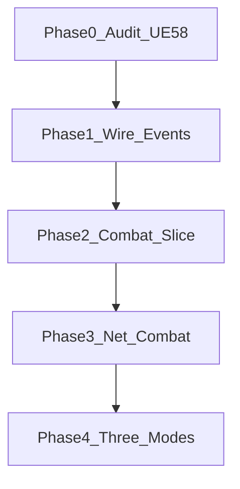

# Gods of the Arena — Implementation Roadmap

**Date:** 2026-10-27  
**Engine target:** **UE 5.8 only**  
**Current branch:** `cpp-branch`

---

## North-star proof (do this before expanding modes)

> One hero (`BP_Player`), one weapon (sword **or** axe), one arena (`ThirdPersonMap`), one intelligent enemy (`BP_Enemy_Melee`), **perfect parry**, **perfect dodge**, **one divine counterattack** — then the same encounter over the network.

All Story / PvE / PvP modes must share that combat foundation.

---

## Phase 0 — Discovery & recovery (this milestone)

**Status: Complete (static audit + Source flatten + UE 5.8 compile)**

| Deliverable | Done |
|-------------|------|
| Project audit | `Docs/GOTA_PROJECT_AUDIT.md` |
| Technical debt | `Docs/GOTA_TECHNICAL_DEBT.md` |
| Asset inventory | `Docs/GOTA_ASSET_INVENTORY.md` |
| Roadmap | this file |
| Flat Source `Public\|Private/{Characters,Combat,Events}` | Yes |
| Engine upgrade 5.3 → 5.8 | Yes; Editor module build **Succeeded** |
| `ULockonComponent` real behavior | Yes |
| `UCombatComponent` + `CombatEvents` observer shell | Yes |
| `UStatsComponent` Health/Stamina/DivineMomentum | Yes |
| Editor BP graph capture | **Deferred** — Unverified (static only) |
| Content mass move | Explicitly deferred |

**Acceptance:** Existing content preserved; build known good on 5.8; systems inventoried.

---

## Phase 1 — Engineering foundation

**Goal:** Contracts without breaking BP combat.

1. Open project in UE 5.8 editor; resave critical assets; fix redirectors.
2. Capture BP behavior for `BP_Player`, `BPC_Attacks`, `BPC_DamageSystem`, weapons, Framework replication (fill Unverified rows).
3. Wire `UCombatComponent` Notify* calls from existing BP attack/parry/block nodes (no rule rewrite).
4. Optionally attach `ULockonComponent` / `UStatsComponent` / `UCombatComponent` to `BP_Player` if not already present.
5. Add Gameplay Tag data asset taxonomy (`State.Combat.*`) — lightweight.
6. Decide GAS: adopt vs extend custom Stats (document in Architecture doc).
7. Enable chosen Online Subsystem only after lobby audit.
8. Add Automation smoke test for Stats clamp / DivineMomentum consume.

**Acceptance:** Project opens cleanly on 5.8; events fire from existing combat; no intentional BP feature regressions.

---

## Phase 2 — Combat vertical slice

**Scope:** `BP_Player` + sword/axe + `BP_Enemy_Melee` + ThirdPerson arena.

| Feature | Approach |
|---------|----------|
| Light / heavy / combo | Preserve `BPC_Attacks`; tune data |
| Block / timed parry / perfect parry | Capture existing windows; expose timing DataAsset |
| Dodge / perfect dodge | Add anim + invuln window in C++/BP |
| Counter after perfect parry | Montage + damage notify |
| Divine counter | Spend DivineMomentum; reuse AOE/Lightning placeholder |
| Hit reactions / stagger | Existing melee/boss hooks |
| Lock-on | `ULockonComponent` + `IA_Lockon` |
| Debug | Draw parry/dodge windows, lock target |

**Acceptance:** Full offensive/defensive loop feels intentional; timings tunable; encounter reliable in PIE.

---

## Phase 3 — Multiplayer combat

1. Server-authoritative damage via Stats/DamageSystem single path.
2. Validate parry/dodge windows server-side (timestamp / tolerance).
3. Replicate combat state; clients play montages/cues.
4. Broadcast cosmetic events locally from RepNotifies / GameplayCues — not as authority.
5. Test 2-client listen server under latency/packet loss.

**Acceptance:** Two clients agree on outcomes; documented latency behavior.

---

## Phase 4 — Three-mode prototype

Shared combat + thin mode layers:

- One co-op story encounter (objectives + revive stub)
- One PvE wave arena (wave GameState)
- One PvP 1v1 duel (match lifecycle)

---

## Phases 5–10 (summary)

| Phase | Focus |
|-------|--------|
| 5 | Five-player co-op, party, scaling, reconnect policy |
| 6 | Combat polish (anim, VFX, audio, camera) |
| 7 | Enemy depth, encounter director, boss prototype |
| 8 | Story/quest expansion |
| 9 | PvE/PvP expansion & balance |
| 10 | Optimization, packaging, release readiness |

---

## Dependency order

Do not scaffold Story/PvE/PvP frameworks before Phase 2 combat feel is accepted.

---

## Immediate next action

1. Launch `WarOfGods.uproject` with UE 5.8.  
2. Allow asset resaves.  
3. Document `BPC_Attacks` parry/combo graph into the audit (clear Unverified).  
4. Add dodge placeholder montage and DivineMomentum grant on perfect parry.
