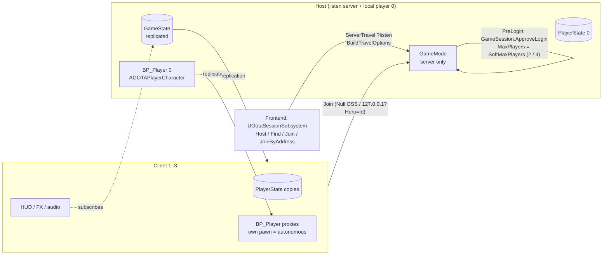
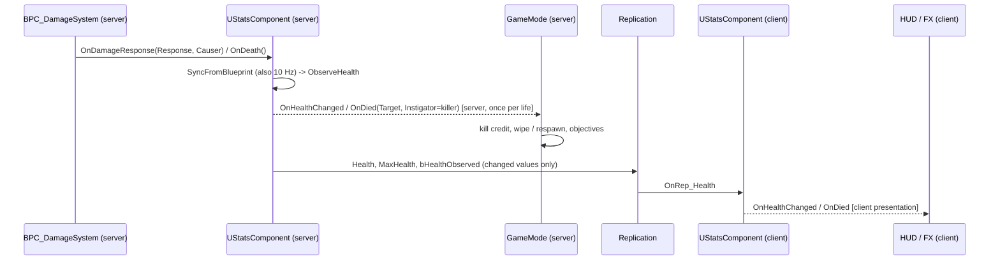

# Gods of the Arena: Multiplayer Architecture

**Model:**
- Listen server (the host plays), up to **4 players** (host + 3 clients).
- Null OSS (LAN / direct IP). Unreal's native replication.
- No custom networking or observer framework.

**Modes:**
- Story co-op (`AGOTAStoryGameMode`, 4)
- Wrath of the Gods / Horde (`AHordeGameMode`, 4)
- Trial of Champions / Duel (`ADuelGameMode`, **2**: 1v1 PvP or 1 vs AI)

See `GOTA_MULTIPLAYER_AUDIT.md` for findings and `GOTA_MULTIPLAYER_TEST_MATRIX.md` for what is verified.

**Packaged checks (2026-11-02):** RC1–RC4 preserved. RC5 is a copy of the RC4 cook at `B:\Unreal\GOTA_Builds\RC5` with shared combat (`GOTACombatLive`) and the remote charge-dodge fix. Pass/fail is in the audit.

## 1. Topology and session flow

- **Join:**
  - The client sends `?Hero=<Id>` in its join URL.
  - The server accepts it in `InitNewPlayer`: Duel → `ADuelPlayerState`; Horde/Story →
    `AGOTAPlayerState::AcceptHeroFromOptions`.
  - The accepted id replicates with OnRep.
  - A rejected or unknown hero falls back to the mode default (In Development heroes need `?DevHeroes=1` /
    `gota.Heroes.AllowInDevelopment`).
- **Cap:**
  - `AGameSession::ApproveLogin` rejects at `MaxPlayers`, which every mode sets from `SoftMaxPlayers` (Duel 2,
    Horde/Story 4).
  - The frontend hall additionally rejects at 4 in `PreLogin`.
- **Host leaves:** clients are sent home (`?closed` loads the main menu). `UGOTAMenuSubsystem` destroys the joined
  session and shows Main Menu (`rc3menuleave2`: `in=1` then `session cleared`, `in=0 screen=MainMenu`). There is no
  host migration. A client who leaves on their own uses `gota.Net.Leave` / `DestroyCurrentSession`; the host keeps
  the match (`rc3leave`).
- **Client leaves:**
  - Duel: a fighter leaving forfeits; a spectator leaving changes nothing.
  - Horde: the team-wipe check counts only connected players.
  - Story: their downed state is dropped.

## 2. Authority and responsibility

| Concern | Lives on | Replicates via | Notes |
|---|---|---|---|
| Match flow, phases, rounds, waves, objectives, outcome | GameMode (server) | GameState properties (`DuelPhase`, `HordePhase`, `MissionPhase`, `MatchOutcome`, …) with OnRep | Outcome functions are guarded to run once (`bMatchComplete`, `bMatchEnded`, `bMissionFlowComplete`) |
| Player identity, hero, score, kills, eliminated flag | PlayerState | `ADuelPlayerState` / `AHordePlayerState` (: `AGOTAPlayerState`) | Only the server writes them |
| **Health / death** | `BPC_DamageSystem` on the **server** (Blueprint, not replicated) | **`UStatsComponent` mirror** (server-created, replicated `Health`/`MaxHealth`/`bHealthObserved`, OnRep) | Server: event-driven (`OnDamageResponse`, `OnDeath`) + 10 Hz sync. Clients: `UGOTACombatantObserver::ReadVitals` reads the mirror |
| Kill credit | Server damage record (`UStatsComponent::LastDamager`) | PlayerState score | Recorded from `OnDamageResponse(…, DamageCauser)` and `FGOTABlueprintCombat::ApplyDamage` |
| Divine Momentum | `UStatsComponent` on the server | `UGOTADuelFighterComponent::Momentum` (+ Stats) | Granted only on the server |
| Melee swing / traces / damage | `BP_Player` + `BPC_Attacks` (server side of `SR_MeleeAttack`) | `MC_*` multicasts (cosmetic, unreliable) | |
| Block / parry state | Server `BPC_DamageSystem.IsBlocking`, `BP_Player.IsWithinParryWindow` | multicasts | Riposte RPC validated by `AGOTAPlayerCharacter` |
| Perfect parry / perfect dodge / Divine Counter | `UGOTADuelFighterComponent` (server) | Cues via `Multicast_Cue` (unreliable), momentum property | Boss impacts judged on the boss timeline (server). Multiplayer parry feedback is a local camera FOV pulse. `CustomTimeDilation` stays 1, so attack timing is not scaled |
| Abilities | `UGOTAHeroAbilityComponent` (server validates, resolves) | `Multicast_BeginCast` (reliable, discrete), `Multicast_Impact` (unreliable), cooldown/status properties | |
| AI, Fight AI director, bosses | Server only (`UGOTAChampionDirectorComponent`, `UGOTABossComponent`) | Boss state/phase/attack properties + reliable animation multicasts | |
| Hero body (cosmetic) | Each machine builds it | `UGOTAHeroBodyComponent::HeroId` (OnRep) | |
| Lock-on, camera, HUD | Local only | — | |

## 3. Trust boundary: every client→server request

| Action | RPC (reliability) | Client provides | Server validates / decides |
|---|---|---|---|
| Attack | `BP_Player::SR_MeleeAttack` (**Reliable**) | nothing | Dropped if the pawn is dead (`AGOTAPlayerCharacter`). Swing, traces and damage all run on the server |
| Spell | `SR_ShootMagicSpell` (**Reliable**) | nothing | Dropped if dead. Projectile and damage on the server |
| Block start/end | `SR_StartBlock` / `SR_EndBlock` (**Reliable**) | nothing | Block state on the server; `TakeDamage` checks it |
| Parry riposte | `SR_ParryAttack(AttackTarget)` (**Reliable**) | target actor | **Validated:** target alive and not self, ≤ 4.5 m, this pawn blocking / in parry window on the server now or within 0.6 s, ≤ 1 per 0.35 s, pawn alive |
| "I blocked" | `SR_OnBlocked(CanbeParried, DamageCauser)` (**Reliable**) | causer | **Validated:** causer alive, ≤ 9 m, server-side defending within 0.6 s |
| Stances / resets / HUD | `SR_*Stance`, `SR_Reset*`, `SR_DisplayHUD` (**Reliable**) | nothing | Cosmetic / state; no damage path |
| Ability | `UGOTAHeroAbilityComponent::Server_Activate(Slot)` (Reliable) | slot index | Round live, alive, not busy, cooldown, momentum, target choice, range, LOS, teleport destination |
| Divine Counter | `UGOTADuelFighterComponent::Server_RequestDivineCounter()` (Reliable) | nothing | Round live, momentum ≥ cost, range to opponent (boss: to capsule edge), not already pending |
| Spawn | `BP_WarOfGods_PlayerController::SR_SpawnPlayer` (Reliable) | nothing | GameMode decides class and start |
| Hero | join URL `?Hero=` | id | Registry validation per mode |
| Legacy | `UCombatTimingComponent::Server_Request*` (Reliable) | client time | Legacy; not used by the duel/boss combat. Do not build on it (client time is untrusted) |

**Clients can never write:** health, damage, momentum, score, kills, eliminated/defeated flags, round/match/mission
outcome, or wave/objective progress. All of it is decided on the server and replicated.

**The host is trusted.** It is the server, and dev console commands (`gota.*`) run on the host. This is acceptable for
listen-server co-op. A competitive PvP release would need a dedicated server.

## 4. Observer and delegate flows (Unreal-native)

Rules this project follows:
- **Delegates don't replicate.**
  - Server-side gameplay listens on the server (`OnDied`, `OnEnemyDefeated`, GameMode handlers).
  - Clients get OnRep-driven events (`OnRep_Health` → `OnHealthChanged`, `OnRep_HeroId` → `OnHeroChanged`,
    `OnRep_MatchOutcome`, `OnRep_HordePhase`, …).
- **No double dispatch on the host.** The server broadcasts when it changes a value; OnRep doesn't run on the server.
  Death is broadcast once per life (`bDeathBroadcast`, reset when health returns).
- **Initial state.** Observers that subscribe late (widget creation, late join) must read the current value first,
  then subscribe. The vitals mirror sets `bHealthObserved` so a reader can tell "no data yet" from "0 HP". Hero and
  outcome properties replicate their current value on join.
- **Teardown.** `UStatsComponent::EndPlay` unbinds the Blueprint delegates, clears its timer and its own multicasts.
  HUD widgets unbind in `NativeDestruct`. Button bindings use `AddUniqueDynamic`.
- **Reliability.** Reliable is used only for discrete events: requests, cast start, phase cues, presentation. Every
  per-hit or cosmetic multicast is Unreliable. Nothing reliable is sent per frame.

## 5. Timing-sensitive mechanics and latency

| Mechanic | Judged | Latency effect | Mitigation |
|---|---|---|---|
| Parry presentation slow-mo | `BP_Player` still calls `SetGlobalTimeDilation` | Listen server would slow **all** pawns / combat clocks | **Redirected in multiplayer:** the `GameplayStatics` function is hooked at startup. Below 1.0 in a non-standalone world, world dilation is put back to 1 and only the local pawn gets `CustomTimeDilation` for `LocalParrySlowMoSeconds`. The per-tick clamp remains as backup. Solo worlds are unchanged. `rc2boss3` logged the redirect on a perfect parry |
| Perfect parry (Blueprint parry window) | Server copy of the defender's block montage | A remote defender's block starts on the server ~RTT/2 late, so the window shrinks by one-way latency | Recommended: favour-the-defender grace (accept a block that started up to min(RTT/2, 100 ms) after the hit for remote defenders), or resolve boss/AI hits against remote players after half their RTT |
| Perfect dodge vs boss | Boss impact time (server) and the dodge's i-frame start (server) | Same one-way shift | Perfect window 0.35 s; dodges inside it are honoured to the impact (`IsDodgeProtected`) |
| Riposte request | Server-side defending state within a 0.6 s grace | Covers RTT up to ~600 ms | `AGOTAPlayerCharacter::ParryGraceSeconds` |
| Divine Counter | Server; 0.3 s presentation delay | None (server-initiated) | — |
| Clock | `GetWorld()->GetTimeSeconds()` on the server only; client timestamps are never trusted | — | Use `GetServerWorldTimeSeconds()` for HUD countdowns (`PhaseDeadlineServerTime` already does) |

## 6. Mode capabilities (four players)

| Capability | Story | Horde | Duel |
|---|---|---|---|
| Max humans | 4 | 4 | 2 (vs AI: 1 + spectators) |
| Per-player hero (validated) | yes | yes | yes |
| Replicated health on clients | yes | yes | yes |
| Death → respawn | 6 s co-op respawn. Server picks a checkpoint or PlayerStart, then separates simultaneous pawns onto a 160 cm ring. 2.5 s invuln | Eliminated players respawn during intermission | round reset; match end tears down fighters/HUD (results crash mitigation) |
| Kill credit | — | per killer | rounds |
| Abilities / momentum / perfect parry-dodge / Divine Counter / bosses | **no** (Duel-only, audit I2) | **no** (I2) | yes |
| Teams / 2v2 / FFA | co-op | co-op | **1v1 only** (I1) |

## 7. Decisions held for later phases

These are the rules for the next passes. RC3 added the menu travel, remote-defender, and cosmetic-parry checks. Shared combat is not started.

- Keep Unreal's native replication. Do not move this game to Iris, Replication Graph, or GAS just to look newer. Four players do not need that machinery until a measured profile says otherwise.
- One source of truth, several observers. `UStatsComponent` remains the replicated health mirror. HUD and animation subscribe locally (`OnRep` / `OnHealthChanged`) and drop the subscription when the pawn ends play. Story, Horde, and Duel already share that mirror. Each mode still decides what a death means (respawn timer, team wipe, round award). Unifying the *reactions* further is the shared-combat phase, after RC2, not a rewrite of the modes that already work.
- Listen server first. Dedicated-server compatibility means GameMode stays server-only and clients do not trust their own damage. It does not mean standing up a dedicated host for this release.
- LAN / direct IP stays. A session-service interface for Epic Online Services is a later phase. RC3 drove Host → Find → Join through the session subsystem. RC4 clicked the Story, Find, session-row, and Start buttons.
- Observers are local. Do not add RPCs whose only job is to tell a widget to refresh.

## 8. Shared combat (RC5)

`GOTACombatLive::IsCombatLive` is the single mode-independent gate. The three `IsRoundLive` implementations call it. Duel still requires `InRound` + `bCombatEnabled`. Story is live in `Active` / `CheckpointReached`. Horde is live in wave and boss phases. No mode fakes Duel state.

**Shared path**

- `UStatsComponent` remains the replicated health and momentum mirror. `BPC_DamageSystem` stays the health authority.
- Story and Horde attach `UGOTADuelFighterComponent` and hero abilities through `GOTACombatLive::EnsurePlayerCombat` (Arena / Story `SetPlayerDefaults`). Opponent refreshes to the nearest living boss.
- Boss `FindTarget` keeps the duel opponent when set; otherwise it picks the nearest living player.
- Perfect dodge under lag: Blueprint `IsInvincible` is client-local. Autonomous clients call `RequestDodgeNotify` → `Server_NotifyDodgeAttempt`, which validates an incoming impact and arms `IsDodgeProtected`. Charge holds at least 0.55 s of remaining protection so a shrinking lead cannot expire mid-rush. Mistimed dodges still take damage (`rc5miss`).
- Divine Counter, momentum, and ability RPCs are unchanged. `gota.Boss.Spawn` (Development) places Quarry Behemoth in Story/Horde for coop validation.

**What stays in the GameMode**

Respawn, team wipe, Horde score and waves, Story objectives, and Duel rounds and forfeit.

**Verified in RC5**

Remote charge perfect-dodge (`rc5charge3`), intentional mistime still hits (`rc5miss`), four-player Story Behemoth with shared combat (`rc5coop2`).
